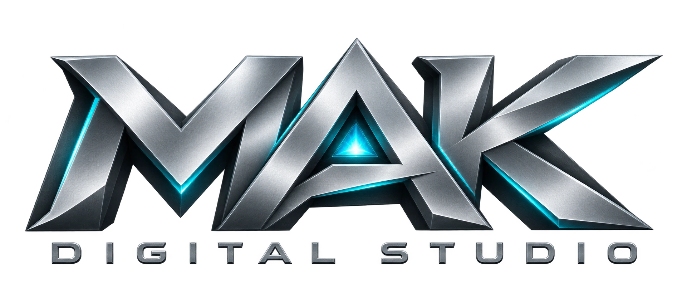

 

### Small ideas. Entire worlds.

I'm **Makenci**, an independent developer based in Germany. 
I build native apps, indie games and the tools that bring them together.

**C++ at the core. A whole world around it.**

[Studio website](https://makdigitalstudio.com/) · [Discord](https://discord.gg/BMKurgjaCa) · [LinkedIn](https://www.linkedin.com/in/thomas-smulski-670708243/) · [Get in touch](mailto:support@makdigitalstudio.com) · [Deutsch](#hallo-ich-bin-makenci)

---

## What I'm building

My current projects live under **MAK Digital Studio** — from practical everyday apps to colourful game worlds. I enjoy working across the whole project: native code, interfaces, original visual assets, desktop tools and databases.

<table>
<tr>
<td valign="top" width="50%">

<h3><a href="https://pferdepass.makdigitalstudio.com/">PferdePass</a></h3>

A companion for everyday horse care. Profiles, health records, appointments, stable notes and backups, with data stored locally.

<strong>Android · C++23 · Qt / QML</strong> Development complete · Google Play testing

<a href="https://pferdepass.makdigitalstudio.com/">Website · DE / EN ↗</a>

</td>
<td valign="top" width="50%">

<h3><a href="https://doggypixeleaters.makdigitalstudio.com/">Doggy Pixel Eaters</a></h3>

A little Chihuahua pack with a big appetite for puzzles. Pick coloured packs, clear paths and collect pixel treats in the right order.

<strong>Android · C++23 · OpenGL ES</strong> Pixel puzzle · In development

<a href="https://doggypixeleaters.makdigitalstudio.com/">Website · DE / EN ↗</a> · <a href="https://discord.gg/TRqu25YKKy">Discord ↗</a>

</td>
</tr>
<tr>
<td valign="top" width="50%">

<h3><a href="https://herofighters.makdigitalstudio.com/">HeroFighters</a></h3>

A colourful fantasy action game with distinctive heroes, monsters, weapons and a growing world. Development includes dedicated tools for building its content.

<strong>Android · C++23 · Native tooling</strong> Fantasy action · In development

<a href="https://herofighters.makdigitalstudio.com/">Website · DE / EN ↗</a> · <a href="https://discord.gg/hNqGumXM9M">Discord ↗</a>

</td>
<td valign="top" width="50%">

<h3><a href="https://idlegalaxyspaceshipfighters.makdigitalstudio.com/">Idle Galaxy Space Ship Fighters</a></h3>

Space combat meets idle progression. Pilot your ship, collect loot, build a fleet and improve its equipment between missions.

<strong>Android · C++23 · OpenGL ES</strong> Space / idle / action · In development

<a href="https://idlegalaxyspaceshipfighters.makdigitalstudio.com/">Website · DE / EN ↗</a> · <a href="https://discord.gg/7RcXRxUw4E">Discord ↗</a>

</td>
</tr>
</table>

**These projects are privately developed.** Their source repositories remain private. This profile is a look at what I'm making, not a public source-code or download catalogue.

## Beyond the game screen

- **Native development** — C++ applications, Android games and desktop utilities.
- **Tools for creators** — editors and workflows for maps, items and game content.
- **Useful software** — turning everyday requirements into focused applications.
- **Data & systems** — database work and clear boundaries between clients, servers and local data.
- **Websites** — independent German/English project sites for the studio's apps and games.

## My toolbox

| Area | Technologies |
| --- | --- |
| Native & desktop | **C++23**, C#, .NET, Qt, QML |
| Games & graphics | Android, OpenGL ES, DirectX 11, Dear ImGui |
| Data | MySQL, MariaDB, Microsoft SQL Server |
| Web | HTML, CSS, JavaScript, Node.js, React |
| Also in the mix | PHP, Lua, Git |

I like understanding how the pieces fit: the app, the interface, the tools and the data behind them.

## Studio & contact

**MAK Digital Studio** is the home for my apps, games and software projects.

- Studio website: **[makdigitalstudio.com](https://makdigitalstudio.com/)** — German and English.
- Each project card links to its own **German / English website**.
- Studio community: **[MAK Digital Studio on Discord](https://discord.gg/BMKurgjaCa)**. The three games have their own Discord links in their cards.
- Project enquiries: **[support@makdigitalstudio.com](mailto:support@makdigitalstudio.com)**.
- Professional contact: **[LinkedIn](https://www.linkedin.com/in/thomas-smulski-670708243/)**.

Public availability and download links will be announced when each project is ready.

---

## Hallo, ich bin Makenci

Unter [**MAK Digital Studio**](https://makdigitalstudio.com/) entwickle ich Apps, Spiele und Software: [**PferdePass**](https://pferdepass.makdigitalstudio.com/), [**Doggy Pixel Eaters**](https://doggypixeleaters.makdigitalstudio.com/), [**HeroFighters**](https://herofighters.makdigitalstudio.com/) und [**Idle Galaxy Space Ship Fighters**](https://idlegalaxyspaceshipfighters.makdigitalstudio.com/).

Mein Schwerpunkt liegt auf **C++**, nativen Anwendungen und den Werkzeugen dahinter. Dazu kommen Qt/QML, Android, Datenbanken und Webentwicklung. Ich mag Projekte, bei denen Technik, Gestaltung und eine konkrete Idee zusammenfinden.

Discord-Communities: [MAK Digital Studio](https://discord.gg/BMKurgjaCa) · [Doggy Pixel Eaters](https://discord.gg/TRqu25YKKy) · [HeroFighters](https://discord.gg/hNqGumXM9M) · [Idle Galaxy](https://discord.gg/7RcXRxUw4E).

**PferdePass ist fertig entwickelt und befindet sich in der Testphase bei Google Play.** Die drei Spiele sind weiterhin in Entwicklung. **Ihre Repositories bleiben privat.** Hier zeige ich einen Einblick in meine Arbeit. Die verlinkten Websites stellen die Projekte auf Deutsch und Englisch vor; öffentliche Downloads folgen nach Freigabe.

 
<strong>Made with ideas, patience and code.</strong> 
Makenci · MAK Digital Studio

