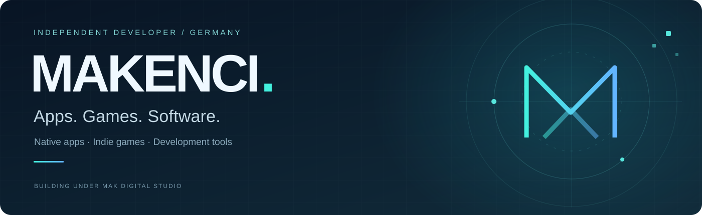
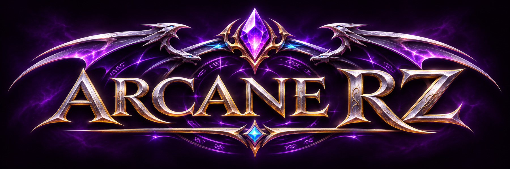

# Hey, I'm Makenci.

**C++ at the core. A whole world around it.**

Independent developer based in Germany. Apps, games and the tools that bring them together.

[MAK Digital Studio](https://github.com/makdigitalstudio) · [Arcane RZ](https://github.com/arcane-rz) · [LinkedIn](https://www.linkedin.com/in/thomas-smulski-670708243/) · [Contact](mailto:support@makdigitalstudio.com) · [Deutsch](#deutsch)

---

## Two project homes. One curious developer.

<table>
<tr>
<td valign="top" width="50%">

<h3>MAK Digital Studio</h3>

My original apps, indie games and MakDigitalEngine: from horse care and Chihuahua puzzles to fantasy worlds and space adventures.

<strong>Apps · Games · Engine development</strong>

<a href="https://github.com/makdigitalstudio">Organisation ↗</a> · <a href="https://makdigitalstudio.com/">Website ↗</a> · <a href="https://discord.gg/BMKurgjaCa">Discord ↗</a>

</td>
<td valign="top" width="50%">

<h3>Arcane RZ</h3>

My independent Rappelz-related project: client and server development, content editors and a native toolchain around an existing game world.

<strong>Client · Server · Native tools</strong>

<a href="https://github.com/arcane-rz">Organisation ↗</a> · <a href="https://arcane-rappelz.com/">Website ↗</a>

</td>
</tr>
</table>

## What I enjoy building

Native applications, responsive interfaces and practical development tools. I like understanding the whole system: the app, its content, the tools and the data behind it.

| Area | Technologies |
| --- | --- |
| Native & desktop | **C++23**, C#, .NET, Qt, QML |
| Games & graphics | Android, OpenGL ES, DirectX 11, Dear ImGui |
| Data | MySQL, MariaDB, Microsoft SQL Server |
| Web | HTML, CSS, JavaScript, Node.js, React |
| Also in the mix | PHP, Lua, Git |

The organisation profiles carry the detailed project introductions. **The project source repositories remain private.** Arcane RZ is independent of the official Rappelz organisation; original game rights remain with their respective owners.

---

## Deutsch

### Moin, ich bin Makenci.

Ich entwickle native Apps, Spiele und Werkzeuge – mit **C++** im Mittelpunkt und Interesse für das gesamte System dahinter.

- **[MAK Digital Studio](https://github.com/makdigitalstudio):** meine eigenständigen Apps und Spiele sowie die eigene MakDigitalEngine. Projektvorstellungen und Communities findest du im Organisationsprofil.
- **[Arcane RZ](https://github.com/arcane-rz):** mein unabhängiges Projekt rund um Rappelz mit Client-/Serverentwicklung, 14 Werkzeugen, eigenen Editoren und Launcher. Die Rechte am ursprünglichen Spiel liegen bei den jeweiligen Rechteinhabern.

Dazu kommen Qt/QML, Android, Datenbanken, Webentwicklung und Desktop-Tools. **Die Projekt-Repositories bleiben privat.** Die beiden Organisationen zeigen die Projekte; dieses Profil zeigt den Entwickler dahinter.

**Made with ideas, patience and code.**

[Studio](https://makdigitalstudio.com/) · [support@makdigitalstudio.com](mailto:support@makdigitalstudio.com)

